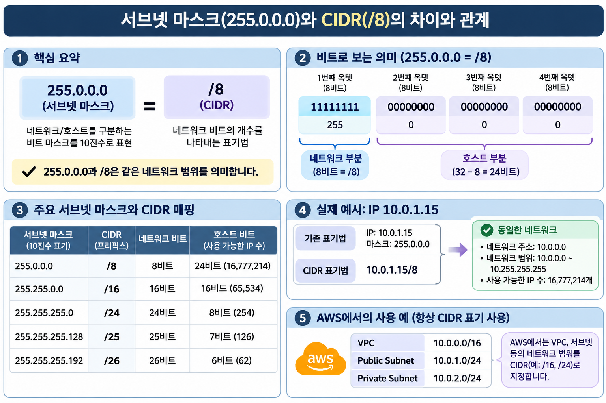
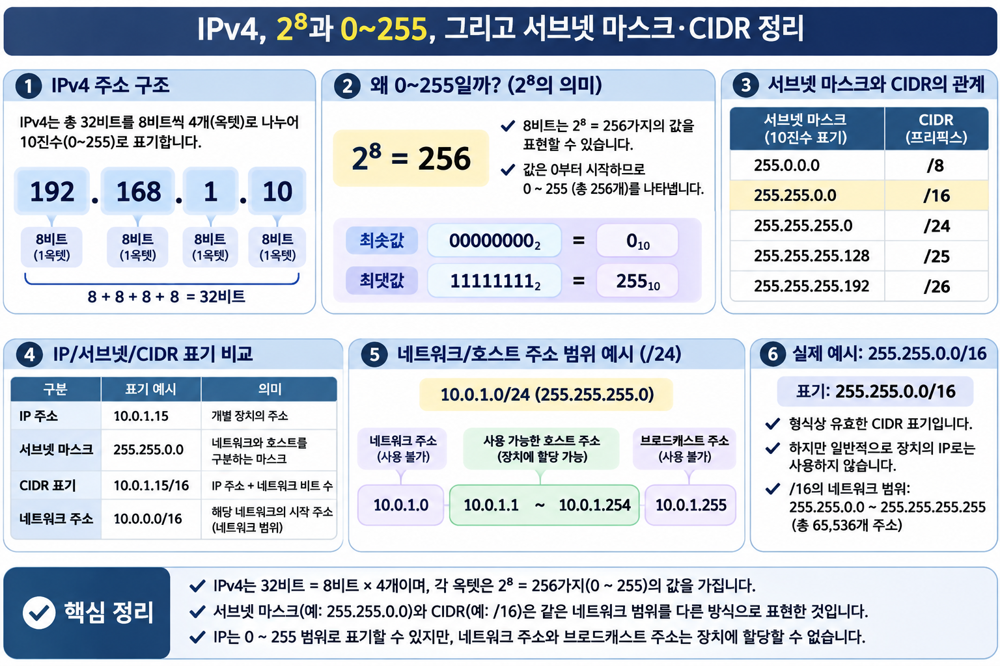
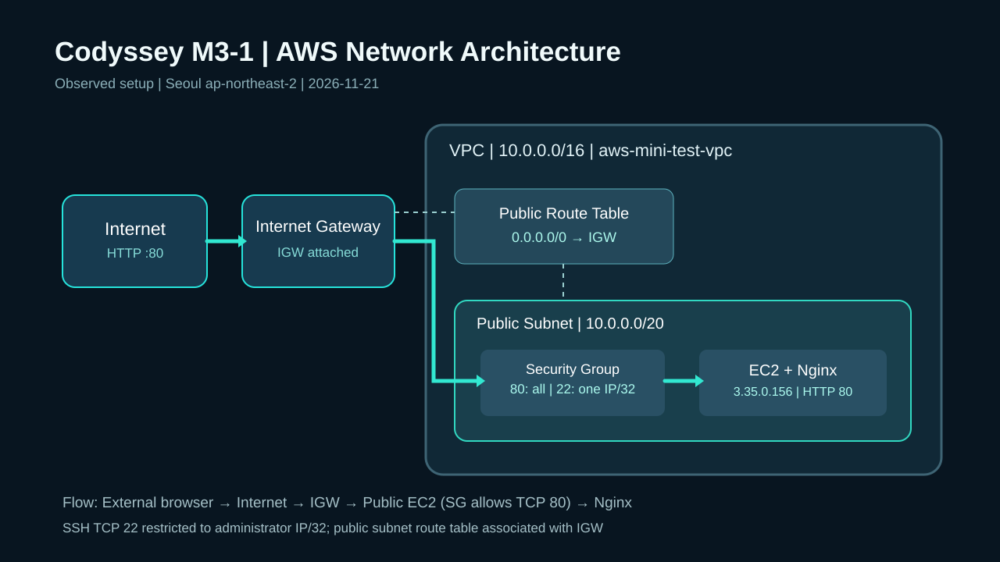

# AWS Mini Test | 네트워크 기초부터 EC2 웹 서버 배포까지

> Codyssey M3-1 · AWS 실습 및 평가 기록  
> **진행 상태 (2026-11-22):** VPC·EC2·SSH·Nginx 구축 및 외부 접속 검증 완료. **리소스 삭제(과제 4)는 미완료**이며, 증빙 이미지의 GitHub 업로드도 확인되지 않았습니다.

## 1. IP 주소·서브넷 마스크·라우트 테이블

IPv4 주소는 **8비트(옥텟) × 4 = 32비트**로 구성됩니다. 각 옥텟은 `2^8 = 256`가지 값을 가지며, **0을 포함해 0~255**로 표현합니다. 256은 가능한 값의 개수이지 최댓값이 아닙니다.

| 개념 | 예시 | 의미 |
|---|---|---|
| IP 주소 | `10.0.1.15` | 장치에 할당되는 주소 |
| 서브넷 마스크 | `255.255.0.0` | 네트워크/호스트 비트 구분 |
| CIDR 표기 | `10.0.1.15/16` | IP 주소와 네트워크 프리픽스 길이 |
| 네트워크 주소 | `10.0.0.0/16` | 해당 네트워크의 범위 |

**학습 이미지 ① — 서브넷 마스크와 CIDR 비교**



**학습 이미지 ② — IPv4의 2⁸=256과 0~255, CIDR 이해**



일반적인 IPv4 /24는 254개 호스트 주소를 사용하지만, AWS VPC /24에서는 AWS 예약 주소 5개로 인해 251개를 할당할 수 있습니다.

### 라우트 테이블 기초

라우트 테이블은 **목적지 네트워크(Destination)**에 따라 **전달 경로(Target)**를 결정합니다.

| Destination | Target |
|---|---|
| `10.0.0.0/16` | `local` |
| `0.0.0.0/0` | `IGW` |

`0.0.0.0/0`은 모든 IPv4 목적지에 일치하는 기본 경로이지, 모든 통신을 허용한다는 뜻은 아닙니다. 목적지 IP에 여러 경로가 일치하면 **라우트 테이블에 실제 등록된 경로 중 가장 긴 프리픽스**를 선택합니다.

[네트워크 기초 상세 설명](docs/network-fundamentals.md)

## 2. 도식화된 AWS 네트워크 흐름



```text
외부 사용자 (웹 브라우저)
        │ HTTP 요청
        ▼
인터넷 ↔ Internet Gateway (IGW)
        │
        ▼
VPC 10.0.0.0/16
        │
        ├─ Route Table
        │    ├─ 10.0.0.0/16 → local
        │    └─ 0.0.0.0/0   → IGW
        │
        └─ Public Subnet 10.0.0.0/20
                 │
                 ▼
          Security Group
          TCP 80 허용
                 │
                 ▼
          EC2 (Nginx 웹 서버)
          사설 IP: 10.0.7.102
```

라우트 테이블은 **목적지에 따른 전달 경로**를 정하고, 보안 그룹은 **허용할 트래픽**을 제어합니다. 외부에서 EC2에 접속하려면 퍼블릭 IP, IGW 연결, 라우트, 보안 설정이 함께 맞아야 합니다.

[아키텍처 상세](docs/architecture.md) · [네트워크 스토리맵](story-map/) · [웹 서버에서 AWS까지](docs/server-to-aws.md)

## 3. AWS 과제 1~4 진행 현황

| 과제 | 제출물 | 진행 상태 | 증빙/설명 |
|---|---|---|---|
| **1. 아키텍처** | VPC·서브넷·IGW·Route Table·EC2·SG 구성도 | **진행 완료 / 최종 이미지 증빙 확인 필요** | [아키텍처](docs/architecture.md) |
| **2. 외부 접속 검증** | 브라우저에서 Nginx 접속 확인 | **검증 완료 / GitHub 캡처 업로드 대기** | 2026-11-21 21:57 KST, `Welcome to nginx!` |
| **3. 트러블슈팅** | 오류·원인·조치·결과 기록 | **작성 완료** | [트러블슈팅](docs/troubleshooting.md) · [서울 리전 문제](docs/seoul-region-troubleshooting.md) |
| **4. 리소스 정리(삭제)** | EC2·EBS·EIP·IGW·VPC 등 정리 | **미완료 — 삭제 확인 및 증빙 필요** | [삭제 체크리스트](docs/cleanup-checklist.md) |

**과제 4는 실제 삭제가 확인되기 전까지 완료 처리하지 않습니다.** EC2와 연결 스토리지, 탄력적 IP, IGW, VPC 등 요금 발생 가능 리소스를 확인하고 정리해야 합니다.

[평가 항목 1~4 (총 17문항)](docs/evaluation-criteria.md) · [평가/증빙 현황](docs/pre-cleanup-evaluation.md) · [평가 가이드](docs/evaluation-guide.md) · [평가자료 PDF](docs/evaluation-handbook.pdf)

---

## 4. 실습 상세 기록

## 서울 리전 전환 결과 (2026-11-21)

**해결 완료:** 초기 가입 환경에서는 시드니 프로젝트 할당 및 서울 접근 제한 경고가 있었으나, 사용자가 Google 신속 가입 대신 Google 계정 가입 방식으로 다시 진행한 후 서울 리전 VPC·EC2 콘솔을 정상 이용했습니다. 이는 사용자 경험으로 확인한 해결 사례이며 모든 AWS 계정에 동일한 가입 방식 제약이 존재한다고 일반화하지 않습니다.

[실제 트러블슈팅 보고서](docs/seoul-region-troubleshooting.md) · [실습 및 평가 현황](docs/pre-cleanup-evaluation.md)

## 실습 환경 / 실제 검증 기록

| 항목 | 실제 사용값 |
|---|---|
| AWS Region | `ap-northeast-2` (서울) |
| VPC | `aws-mini-test-vpc` / `10.0.0.0/16` |
| Public Subnet | `aws-mini-test-subnet-public1-ap-northeast-2a` / `10.0.0.0/20` |
| Internet Gateway | `aws-mini-test-igw` / `igw-01fef922fafa9c6cb` |
| Public Route Table | `aws-mini-test-rtb-public` / `rtb-05c3b69984ea7f365` |
| Route | `10.0.0.0/16 → local`, `0.0.0.0/0 → IGW` (활성) |
| EC2 | Ubuntu 24.04 LTS · `t3.micro` · `i-0b54a3173ed64e7e3` |
| 사설 IP / 당시 퍼블릭 IP | `10.0.7.102` / `3.35.0.156` |
| 웹 서버 | Nginx 1.24.0 · `curl -i http://localhost/` → HTTP 200 OK |
| SG | `aws-mini-test-sg` · TCP 22: 특정 IP/32, TCP 80: 0.0.0.0/0 |
| 외부 검증 | **A 방식 성공** · 2026-11-21 21:57 KST · Welcome to nginx! |
| IAM·태그 세부 정책 | 평가용 별도 IAM 주체 및 실제 태그는 검증 필요. 콘솔 화면의 `root` 사용은 원문 제한사항과 비교 필요 |
| 정리 | EC2/EBS/EIP/IGW/VPC **삭제 미확인** |

[17개 평가 질문별 판정표와 제출물 현황](docs/pre-cleanup-evaluation.md) · [아키텍처 구조](docs/architecture.md)

**보안:** 퍼블릭 IP, 이름, SG 규칙은 공개해도 되는 범위만 기록합니다. AWS 액세스 키, 비밀 키, SSH 개인키(PEM), 계정 번호, 민감 로그는 Git에 절대 올리지 마세요. 공개 저장소의 캡처는 마스킹 후 사용하세요.

## 실행/설정 보조 체크리스트 (평가 항목 1의 5문항과 별개)

- [x] VPC 1개, Public Subnet 1개 생성
- [x] IGW를 VPC에 연결
- [x] Public Subnet이 연동된 Route Table에 `0.0.0.0/0 → IGW` 등록
- [x] Public Subnet의 EC2에 퍼블릭 IPv4 할당, SSH 접속 성공
- [x] 웹 서버 실행, EC2 안에서 `curl -i http://localhost/` 응답 200 확인
- [x] SG 인바운드: TCP 80 = `0.0.0.0/0`, TCP 22 = **특정 공인 IP/32만** 확인
- [ ] IAM은 EC2/VPC/SG 등의 실습 필요 작업으로만 제한하며 AdministratorAccess 사용 안 함 (실제 확인 필요)
- [x] 외부 검증 A 성공, 실제 화면과 접속 정보 확인 (GitHub 이미지 업로드 별도)
- [x] 트러블슈팅 실제 1건 이상 기록
- [ ] 종료 후 리소스 정리 증빙 (최소 5종) 완료

## 서버 배포 및 테스트 예시 (Ubuntu + Nginx)

```bash
# 1. (로컬 컴퓨터) 본인 키 경로, 퍼블릭 IP로 변경
chmod 400 /path/to/lab-key.pem
ssh -i /path/to/lab-key.pem ubuntu@<PUBLIC_IP>

# 2. (EC2 내부) 패키지 설치 및 시작
sudo apt update
sudo apt install -y nginx
sudo systemctl enable --now nginx
sudo systemctl status nginx --no-pager

# 3. (EC2 내부) localhost 응답 확인
curl -i http://localhost/
```

Amazon Linux이면 패키지 관리 명령, SSH 사용자(`ec2-user`)가 달라집니다. 로컬의 SSH `chmod`는 Windows PowerShell에는 그대로 적용되지 않을 수 있습니다.

## 외부 접속 검증 — **A 선택(권장·간단)**

- 방식: **A. 브라우저 http://<PUBLIC_IP> 접속 후 페이지 표시**
- 실제 사용 URL: `http://3.35.0.156/` (실습 시점의 퍼블릭 IPv4; 삭제 후 접속되지 않을 수 있음)
- 검증 시각(KST): 2026-11-21 21:57
- 결과: **성공** · 외부 Chrome에서 `Welcome to nginx!` 표시
- 내부 HTTP: `curl -i http://localhost/` → HTTP 200 OK
- 증빙: 대화에서 캡처 확보, GitHub `docs/evidence/external-browser.png` 업로드는 별도
- 브라우저에서 나온 화면과 주소창(필요 시 일부 마스킹)을 캡처합니다.

대체 방식 B: `curl -i http://<PUBLIC_IP>/health`에서 HTTP 200 및 고정 문구 `OK`를 **실제로 서버에 /health 경로를 구현한 뒤** 검증. Nginx 기본 설치만으로는 `/health`가 자동 제공되지 않습니다.

## 평가 설명 자료

문답 및 상황 대처: [docs/evaluation-guide.md](docs/evaluation-guide.md).

### 통합 평가자료 다운로드

- [평가·실습 자료 PDF (8쪽)](docs/evaluation-handbook.pdf)
- [수정 가능한 Markdown 원본](docs/evaluation-handbook.md)

항목 1~4의 17개 평가 기준, 제안 배점, 실습 가이드, 예상 답변, 장애 대응 및 리소스 정리 체크리스트를 묶었습니다. 배점은 공식 기준이 아닌 제안안이며 실제 실습 결과는 기입란으로 남겨두었습니다.

통합 자료의 실습 예제는 **Amazon Linux 2023 + B 방식(`/health`)**입니다. 위 README의 **Ubuntu + A 방식(브라우저)**과는 선택 가능한 별도 예제입니다. 실제 사용하는 OS와 검증 방식 하나에 맞춰 명령·설정·증빙을 작성하세요. 태그 예시도 실제 프로젝트에서 정한 규칙 하나로 통일하세요.

## 실습 후 정리 및 제출

[실습 후 가이드](docs/after-lab.md)에 따라 EC2가 살아 있을 때 외부 접속 증빙을 남기고, 실제 구성과 장애 대응을 기록하세요. AWS 리소스를 정리한 뒤 제출물 4종을 평가 기준에 대조할 수 있습니다.

> 실제 AWS 구성 및 접속 성공은 사용자 제공 콘솔 캡처·터미널 로그를 근거로 기록했습니다. 리소스 삭제 및 과금 정리는 아직 확인되지 않았습니다.
