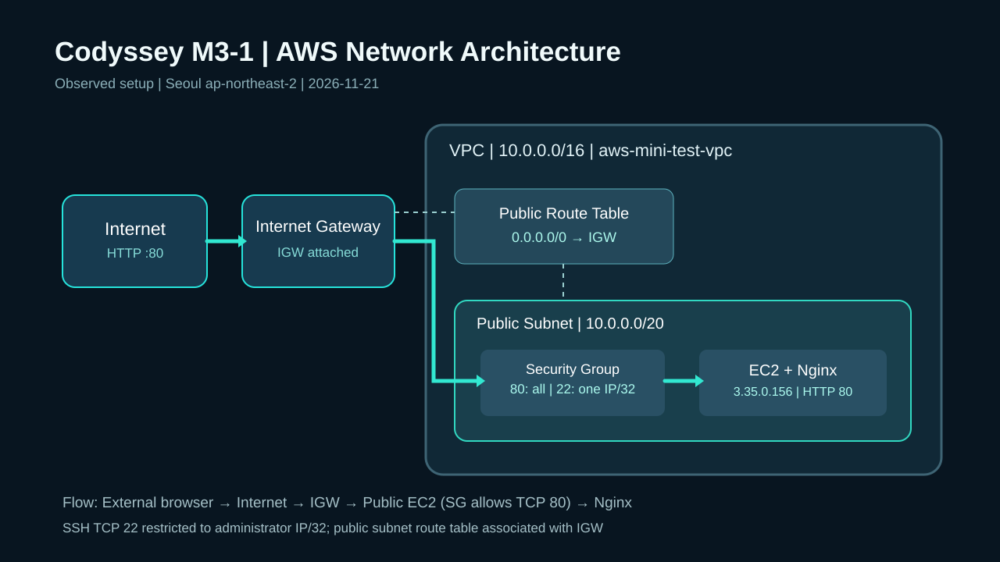
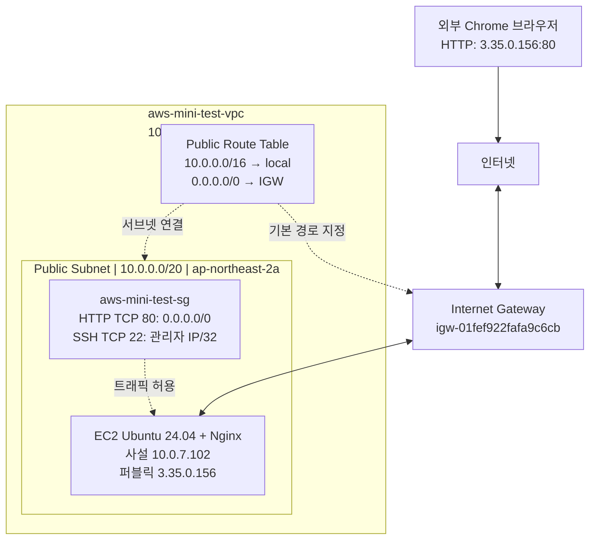

# 네트워크 아키텍처 — 구성 설명 및 다이어그램

**실제 구성 (사용자가 제공한 콘솔 캡처 기준, 2026-11-21):** 서울 `ap-northeast-2`, VPC `10.0.0.0/16`, Public Subnet **`10.0.0.0/20`** (`ap-northeast-2a`), EC2 `10.0.7.102`(사설) / `3.35.0.156`(당시 퍼블릭 IPv4). 과거 문서의 `10.0.1.0/24`는 예시이므로 실제 서브넷과 다르게 수정했습니다.

실제 아키텍처 Mermaid 원본 보기

## 외부 요청 흐름 (항목 2)

1. 외부 브라우저가 EC2의 퍼블릭 IPv4:80으로 요청합니다.
2. 트래픽은 인터넷과 **VPC에 연결된 IGW**를 거쳐 대상 EC2의 네트워크 인터페이스로 전달됩니다.
3. Public Subnet의 연결된 Route Table은 기본 경로 `0.0.0.0/0 → IGW`를 가져 인터넷 송수신 경로를 구성합니다. 이 규칙이 없으면 일반적인 IPv4 인터넷 접속 경로가 성립하지 않습니다.
4. 보안 그룹 인바운드가 TCP 80 요청을 허용하고 EC2의 Nginx가 처리해 응답합니다. 응답은 상태 저장형 SG의 반환 트래픽 허용을 이용해 클라이언트로 돌아갑니다.
5. SSH 관리는 TCP 22를 특정 관리자 IP/32에만 허용합니다.

**정확성 유의:** Route Table의 0.0.0.0/0은 주로 인스턴스에서 인터넷으로 나가는 경로를 지정하고, IGW가 외부와의 양방향 연결을 지원합니다. 퍼블릭 IPv4, SG, Network ACL, 인스턴스 리스닝 상태도 외부 접근 조건입니다. IGW가 SG를 순서대로 '통과'하는 물리적 상자가 아니라 논리적으로 서로 다른 제어 요소임을 설명하세요.

## 설계 검증 자료

| 확인 항목 | 콘솔 위치 | 증빙 |
|---|---|---|
| VPC CIDR | VPC → Your VPCs | 10.0.0.0/16 확인 |
| Subnet CIDR/공개 여부 | EC2 → 네트워크 설정 / VPC Subnets | 10.0.0.0/20, Public Subnet 확인 |
| IGW 연결 | VPC 리소스 맵 | aws-mini-test-igw 연결 화면 확인 |
| 0.0.0.0/0 기본 경로 및 연결 | VPC → Route Tables → Routes / Subnet associations | igw-01fef922fafa9c6cb · 활성 확인 |
| EC2 퍼블릭 IPv4 | EC2 인스턴스 목록 | 3.35.0.156 (실습 시점) |
| SG TCP 80 / SSH 22 소스 | EC2 → Security Groups → Inbound rules | 실제 2개 규칙 캡처 확인 |

원문 제출 파일 형식은 **PNG 또는 PDF 1장**입니다. 이 SVG는 GitHub 미리보기용 편집 가능한 다이어그램이므로 제출 시 PNG/PDF로 내보내세요. 실제 AWS 리소스는 **아직 삭제하지 않았습니다.**
