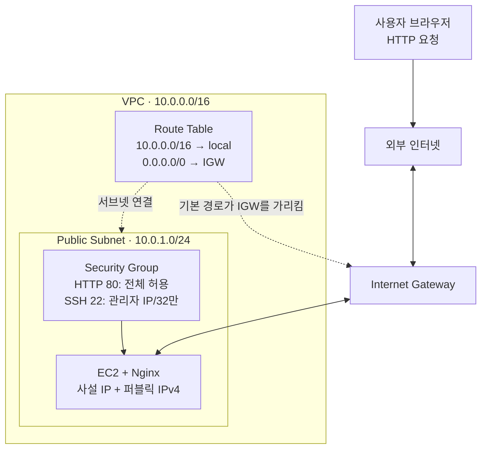
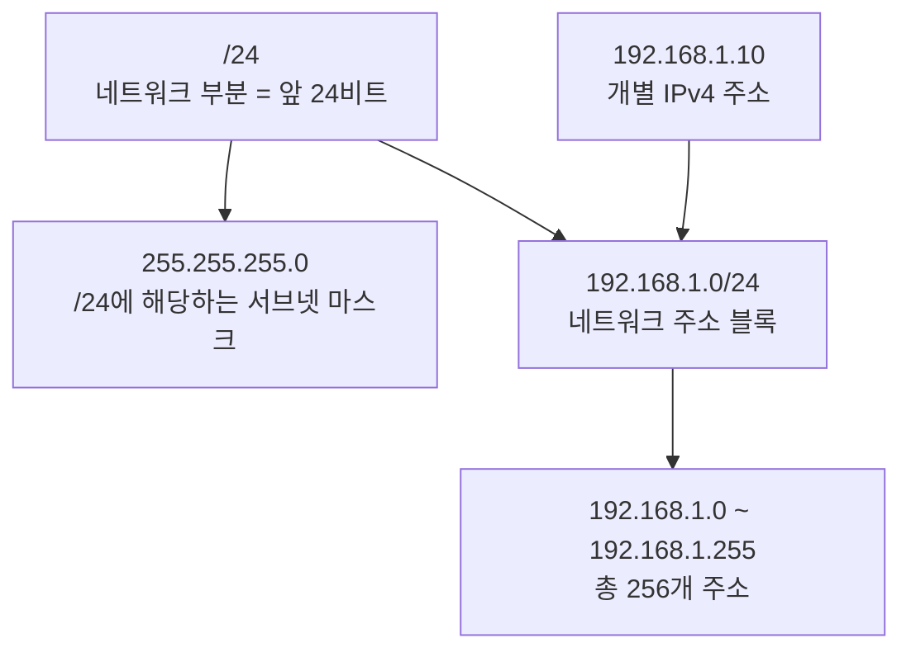
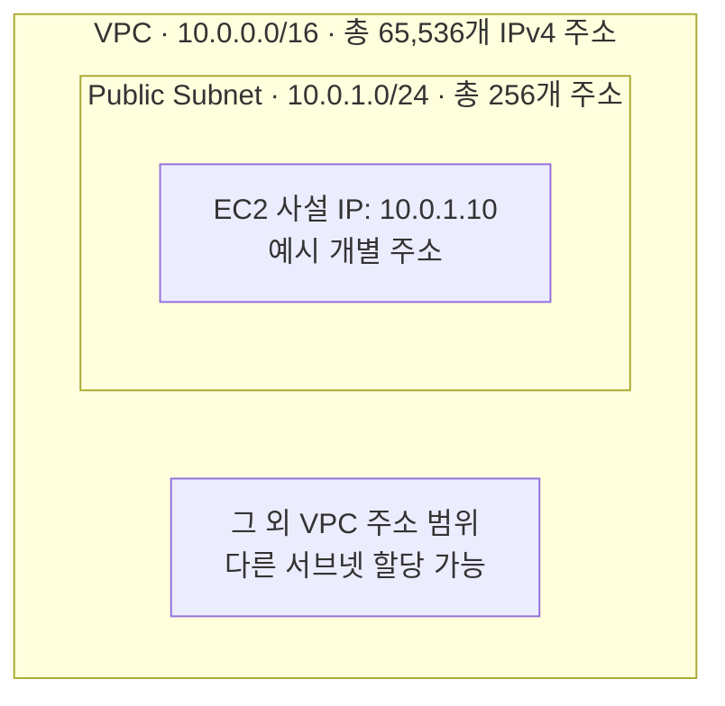
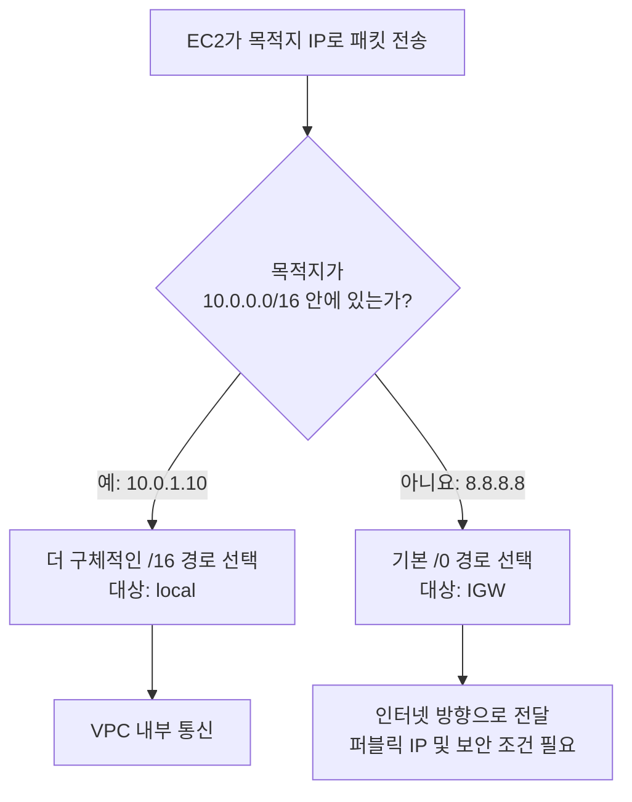

# AWS 네트워크 기초 학습 노트 — IP, 서브넷, CIDR, 라우팅

> 미션 3-1을 시작하기 전에 대화에서 학습한 핵심 개념 정리. 아래 IP 주소와 구성은 **설명용 예시**이며 실제 AWS 구축 결과가 아닙니다.

## 1. AWS에서 웹사이트를 공개하는 전체 구조

### 그림 1. AWS 웹 서버 공개 구조도



> 화살표는 이해를 위한 **논리적 통신 관계**입니다. 보안 그룹은 EC2 네트워크 인터페이스에 적용되는 접근 규칙이며 별도의 물리적 중계 장비는 아닙니다.

```text
외부 브라우저 (HTTP 요청)
        │
      인터넷
        │
Internet Gateway (IGW) ── VPC에 연결
        │
VPC (10.0.0.0/16)
  └─ Public Subnet (10.0.1.0/24)
       ├─ 연결된 Route Table: 0.0.0.0/0 → IGW
       └─ EC2 (퍼블릭 IPv4 필요)
           ├─ Security Group: HTTP 80 허용, SSH 22는 내 IP/32
           └─ Nginx (웹 서버)
```

> 이 그림은 논리적 구조입니다. IGW가 Route Table과 Security Group을 물리적으로 순서대로 통과하는 장치라는 뜻은 아닙니다. 실제 인터넷 접속에는 IGW 연결 + 서브넷 경로 + 퍼블릭 IPv4 + SG 및 서비스 상태가 함께 맞아야 합니다.

| 개념 | 비유 | 실제 역할 |
|---|---|---|
| VPC | 독립된 건물 | AWS 리소스를 위한 논리적으로 격리된 가상 네트워크 |
| Subnet | 건물 안 구역 | VPC 주소 범위의 일부를 나눈 공간 |
| Internet Gateway (IGW) | 건물의 외부 출입구 | VPC와 인터넷 통신을 지원하는 게이트웨이 |
| Route Table | 길 안내표 | 목적지 IP에 따라 트래픽을 어디로 보낼지 지정 |
| Security Group | 출입 통제 | 네트워크 트래픽의 허용 규칙(상태 저장형) |
| EC2 | 서버 컴퓨터 | Nginx 같은 웹 서비스를 구동 |
| Traffic | 도로 위 이동 | 네트워크를 통해 오가는 데이터의 흐름 또는 양 |

### 게이트웨이(Gateway)와 트래픽(Traffic)

- **게이트웨이**: 서로 다른 네트워크 사이에서 통신을 중계하거나 연결하는 지점·장치·기능을 뜻하는 일반 용어.
- **Internet Gateway**: AWS VPC의 인터넷 연결을 담당하는 특수한 게이트웨이.
- **트래픽**: 브라우저가 웹 서버에 페이지를 요청하는 데이터와 서버가 HTML·이미지 등을 응답하는 데이터의 흐름. 트래픽 양은 보통 MB·GB, 전송 속도는 Mbps 등으로 표현.
- **주의**: IGW를 연결하기만 해서는 모든 EC2가 인터넷에 노출되지 않음.

## 2. IP 주소 vs 서브넷 마스크 vs CIDR vs Route Table

| 구분 | 예시 | 질문에 대한 답 |
|---|---|---|
| 개별 IPv4 주소 | `192.168.1.10` | “어느 장치의 주소인가?” |
| 서브넷 마스크 | `255.255.255.0` | “주소 중 네트워크 비트가 어디까지인가?” |
| CIDR 프리픽스 길이 | `/24` | “앞에서 몇 비트가 네트워크 부분인가?” |
| CIDR 네트워크 표기 | `192.168.1.0/24` | “어떤 IP 주소 범위인가?” |
| 라우팅 규칙 | `0.0.0.0/0 → IGW` | “해당 목적지로 가는 데이터를 어디로 보낼까?” |

**중요:** CIDR은 네트워크 주소와 프리픽스 길이로 주소 블록을 표현하는 방식 및 주소 할당/라우팅 체계입니다. **`/24` 부분**은 연속형 IPv4 서브넷 마스크 `255.255.255.0`과 같은 경계를 뜻하지만, CIDR 전체를 단순히 '서브넷 마스크 별명'으로 이해하면 부족합니다.

### 그림 2. IP 주소와 /24 프리픽스 관계



**구분:** `192.168.1.10`은 한 주소, `192.168.1.0/24`는 주소 범위, `255.255.255.0`은 비트 경계를 나타내는 마스크입니다.

### `10.0.1.0/24` 읽는 법

- `10.0.1.0`: IPv4 형식으로 적힌 **네트워크 주소**(해당 /24 블록의 시작).
- `/24`: 주소 32비트 중 **앞 24비트가 네트워크 부분**이라는 뜻.
- 대응 서브넷 마스크: `255.255.255.0`
- 포함 주소: `10.0.1.0 ~ 10.0.1.255` (총 256개 주소).
- 전통적인 일반 IPv4 LAN 기준 호스트 범위: `10.0.1.1 ~ 10.0.1.254`. **AWS 서브넷에서는 앞의 4개와 마지막 1개 IP를 예약**하므로 EC2에 할당 가능한 범위는 이 일반 규칙보다 좁음.

### 비트로 살펴보기

```text
IPv4 주소             192.168.1.10
2진수                 11000000.10101000.00000001.00001010
/24 마스크            11111111.11111111.11111111.00000000
10진수 마스크         255     .255     .255     .0

                      └──────── 네트워크 24비트 ────────┘ └호스트 8비트┘
```

서브넷 마스크는 **앞쪽 연속된 1비트 + 뒤쪽 연속된 0비트**로 구성됩니다. 일반적인 IPv4 CIDR 프리픽스는 `/0 ~ /32`로 **33가지**입니다.

| CIDR | 서브넷 마스크 | 블록 내 전체 IPv4 주소 수 |
|---|---|---:|
| /0 | 0.0.0.0 | 4,294,967,296 |
| /8 | 255.0.0.0 | 16,777,216 |
| /16 | 255.255.0.0 | 65,536 |
| /24 | 255.255.255.0 | 256 |
| /25 | 255.255.255.128 | 128 |
| /26 | 255.255.255.192 | 64 |
| /27 | 255.255.255.224 | 32 |
| /28 | 255.255.255.240 | 16 |
| /30 | 255.255.255.252 | 4 |
| /32 | 255.255.255.255 | 1 |

**핵심 공식:** 블록 내 총 주소 수 = `2^(32 - 프리픽스 길이)`. 이는 총주소 수이지 실제 사용 가능한 EC2 IP 수가 아닙니다. /31, /32 및 AWS 환경의 예약 규칙은 별도로 고려해야 합니다.

## 3. VPC의 /16과 서브넷의 /24

### 그림 3. 큰 VPC 주소 범위 안의 작은 서브넷



```text
VPC             10.0.0.0/16   → 10.0.0.0 ~ 10.0.255.255
└─ Public Subnet 10.0.1.0/24  → 10.0.1.0 ~ 10.0.1.255
   └─ EC2 사설 IP 10.0.1.10   → 해당 서브넷의 한 개별 주소 (예시)
```

`/16`보다 `/24`가 네트워크 부분이 더 길어서 **개별 블록은 더 작습니다.** 즉 **VPC 큰 주소 블록 안에 서브넷 작은 주소 블록**을 만들 수 있습니다.

## 4. Route Table의 `0.0.0.0/0`은 IP 주소인가?

### 그림 4. 목적지 IP에 따라 경로 결정



**이유:** `10.0.1.10`은 `/16`과 `/0` 두 경로에 모두 일치하지만, 더 구체적인 `/16`을 우선합니다.

라우팅 테이블에서 `0.0.0.0/0`은 **모든 IPv4 목적지와 일치하는 기본 경로(Default Route)**입니다. 특정 컴퓨터의 주소를 뜻하는 것이 아닙니다.

| 목적지(Destination) | 대상(Target) | 설명 |
|---|---|---|
| `10.0.0.0/16` | local | VPC 내부 목적지로 통신 |
| `0.0.0.0/0` | IGW | 다른 경로에 더 구체적으로 일치하지 않는 IPv4 목적지는 IGW로 전달 |

**최장 프리픽스 일치(Longest Prefix Match):** 목적지 IP에 여러 경로가 일치하면 가장 구체적인(프리픽스 길이가 가장 긴) 경로를 우선 선택합니다.

| 실제 목적지 | 일치하는 경로 | 선택된 대상 | 이유 |
|---|---|---|---|
| `10.0.1.10` | /16 및 /0 | local | /16이 /0보다 구체적 |
| `8.8.8.8` | /0 | IGW | VPC 범위 밖의 목적지 |

`0.0.0.0/0 → IGW`는 **길을 정하는 규칙**일 뿐, 모든 포트를 열어주는 보안 설정은 아닙니다. 실제 접속 허용은 Security Group, 네트워크 ACL, 퍼블릭 IP, 서버 상태 등도 좌우합니다.

## 5. 미션 3-1 실습 연결

1. VPC `10.0.0.0/16` 생성
2. Public Subnet `10.0.1.0/24` 생성
3. IGW 연결 및 Public Route Table에 `0.0.0.0/0 → IGW` 구성/연동
4. EC2 실행 후 퍼블릭 IPv4 확인, SG HTTP(80) 공개 + SSH(22) 내 IP/32 제한
5. Nginx 설치 및 외부 브라우저 `http://<EC2 퍼블릭 IP>` 접속 테스트
6. 증빙 캡처와 실습 종료 후 리소스 정리

아직 **실제 AWS 리소스 생성이나 외부 접속 성공이 확인된 것은 아닙니다.** 미션의 평가 기준은 [evaluation-criteria.md](evaluation-criteria.md), 실제 구성도는 [architecture.md](architecture.md) 참조.

## 6. 셀프 체크

1. `10.0.1.0/24`의 `10.0.1.0`은 개별 EC2 주소인가, 네트워크 주소인가?
2. `/24`와 `255.255.255.0`은 어떤 관계인가?
3. `10.0.0.0/16` 안에 `10.0.1.0/24`를 넣을 수 있는 이유는?
4. `0.0.0.0/0 → IGW`를 만들면 보안 그룹의 포트도 자동 개방될까?

<details><summary>정답 보기</summary>

1. /24 범위의 **네트워크 주소**.
2. 동일한 네트워크/호스트 비트 경계를 표현.
3. /24 범위가 /16 범위 안에 완전히 포함되기 때문.
4. **아니요.** Route Table은 경로만 결정하고 SG는 별도로 설정.

</details>
