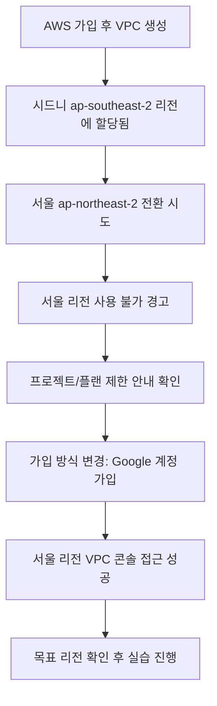

# 트러블슈팅: AWS 서울 리전 사용 불가 → 가입 방식 변경으로 해결

> 발생 및 해결: 2026-11-21 (KST) · 미션 3-1 · **실제 사용자 경험을 바탕으로 작성**
>
> **해결 상태: 서울 리전 VPC 콘솔 접근 확인.** 단, 서울 리전의 EC2 생성/웹 서버 공개/HTTP 200 응답까지 검증한 것은 아닙니다.

## 1. 증상

기존 AWS 콘솔에서는 시드니(`ap-southeast-2`) 리전만 이용할 수 있었고, 서울(`ap-northeast-2`)로 전환하자 **"아시아 태평양(서울) 리전 사용 불가"** 경고가 표시되었습니다.

경고문에는 프로젝트가 시드니에 할당되어 있으며, 다른 AWS 리전을 사용하려면 플랜 업그레이드 후 고급 기능을 활성화하라는 안내가 있었습니다. 사용자는 유료 전환 없이 서울 리전을 이용하려고 했습니다.

### 증빙 1 — 시드니 리전에서 생성된 리소스

- 화면에 `ap-southeast-2a` 가용 영역 및 시드니 VPC의 퍼블릭 라우팅 테이블이 표시됨
- 외부 경로 `0.0.0.0/0 → IGW`는 정상적으로 구성되었으나, **과제 요구 서울 리전과 일치하지 않음**

### 증빙 2 — 서울 리전 사용 불가 경고

- "아시아 태평양(서울) 리전 사용 불가" 메시지
- 프로젝트의 시드니 리전 할당 및 고급 기능 활성화 안내가 표시됨

## 2. 가설 → 검증 → 조치 → 결과

| 단계 | 실제 수행/확인 내용 |
|---|---|
| **증상** | 시드니에서 생성된 VPC는 보였으나 서울 리전으로 변경 시 제한 경고 발생 |
| **가설 1** | VPC 또는 Route Table 설정 때문에 서울로 변경되지 않을 수 있음 |
| **검증 1** | 시드니의 VPC/Route Table 화면과 서울 리전 접근 경고를 비교; VPC를 삭제해도 계정의 리전 사용 제한과 무관함을 확인 |
| **가설 2** | AWS 계정 생성/로그인 방식에 따라 사용 가능한 리전이나 프로젝트 제한이 다를 수 있음 |
| **검증 2** | 사용자가 기존 **'Google 신속 가입'** 대신 **'Google 계정으로 가입'**하는 방식을 직접 시도 |
| **실제 조치** | Google 계정 가입 방식으로 AWS에 접속 |
| **결과** | **서울(`ap-northeast-2`) VPC 대시보드 진입 성공**, VPC 1개·서브넷 4개 등 서울 리전 리소스가 표시됨 |
| **재발 방지** | 계정 유형/프로젝트 할당 리전/플랜 제한 확인 → 실제 서비스 리전 표시 확인 → 네트워크 생성 전 목표 리전 확인 |

### 증빙 3 — 해결 후 서울 리전 접속

- 우측 상단 리전: **아시아 태평양(서울)**
- VPC 대시보드에도 리전별 리소스 집계 표시
- 이는 **서울 VPC 콘솔 진입 성공**을 보여주는 증거이며 EC2 접속 또는 외부 웹 서버 접속 성공 증거는 아닙니다.

## 3. 원인 판단에서 구분할 부분

- **직접 관찰된 사실:** 이전 계정/프로젝트에서는 시드니 리전 할당과 서울 사용 불가 경고가 발생함. 가입 방식을 바꾸어 접속한 뒤 서울 VPC 콘솔 접근이 가능해짐.
- **사용자가 확인한 해결 방법:** 'Google 신속 가입'이 아닌 'Google 계정으로 가입'하는 방식 사용.
- **아직 일반화할 수 없는 부분:** 모든 AWS 신규 계정에서 'Google 신속 가입 = 시드니만 사용 가능'이라는 보편 규칙이 성립한다고 검증한 것은 아님. 계정 유형, 플랜, 프로젝트 생성 방식 등이 함께 달랐을 가능성이 있음.
- **중요:** 리전 전환 실패의 근본 원인은 네트워크 대역이나 IGW 라우팅 문제가 아니라, **이전에 이용한 계정/프로젝트의 접근 제한**으로 판단됨.

## 4. 실제 트러블슈팅 흐름

## 5. 미션 평가 항목과 연결

- **항목 3-4:** 무작정 SG/IAM 설정을 바꾸지 않고 화면 경고와 리전·프로젝트 상태로 가설을 좁혔음.
- **항목 4-2:** 접근 문제를 권한 무조건 확대 문제로 취급하지 않고 실제 사용 제한 메시지를 확인했음. IAM 세부 정책을 검증한 사례는 아님.
- **제출물 3:** 실제 **증상 → 가설 → 검증 → 조치 → 결과 → 재발 방지** 트러블슈팅 1건에 해당.
- **별도 필요:** 웹 서버 외부 접속 증빙(A/B), EC2 배포 및 리소스 삭제 체크리스트는 여전히 별도로 준비.

## 6. 스크린샷 관련 개인정보 주의

스크린샷은 계정 식별자·상단 사용자 메뉴·브라우저 주소창의 계정 번호가 보이지 않도록 **필요한 영역만 잘라서** 사용하세요. 스크린샷 파일은 `docs/evidence/`에 보관합니다.
