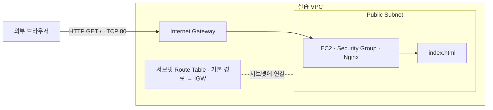

# 웹 서버의 기본부터 AWS EC2까지

내 컴퓨터에서 `http://localhost:8000/`이 열렸다고 하자. 다른 사람이 자기 컴퓨터에서 같은 사이트를 열려면 무엇이 더 필요할까? 이 질문을 따라 웹 서버의 기본 원리와 AWS 실습 구성을 연결한다.

## 1. 웹 서버는 어떤 일을 하나?

서버는 클라이언트의 요청을 받아 응답한다. ‘서버’는 프로그램이 실행되는 컴퓨터를 가리키기도 하고, 요청을 처리하는 프로그램을 가리키기도 한다. 이번 실습에서 **EC2는 컴퓨터**, **Nginx는 그 컴퓨터에서 실행되는 웹 서버 프로그램**, **브라우저와 `curl`은 요청을 보내는 클라이언트**다.

예를 들어 브라우저가 `GET /`을 보내면 웹 서버는 `/`에 대응하는 `index.html`을 읽어서 상태 코드 `200`과 HTML을 반환할 수 있다. 브라우저가 받은 HTML을 화면으로 보여준다. 매번 같은 파일을 돌려주는 방식이 정적 사이트다. 로그인이나 검색처럼 요청에 따라 응답이 달라지는 사이트에서는 애플리케이션이 응답을 만들고 필요에 따라 데이터베이스를 조회한다. [MDN 웹 서버 설명](https://developer.mozilla.org/en-US/docs/Learn_web_development/Howto/Web_mechanics/What_is_a_web_server) · [MDN HTTP 개요](https://developer.mozilla.org/en-US/docs/Web/HTTP/Guides/Overview)

| URL의 요소 | `http://127.0.0.1:8000/`에서 하는 일 |
| --- | --- |
| `http://` | 요청과 응답에 사용할 프로토콜이다. HTTPS는 HTTP 통신을 TLS로 보호한다. |
| `127.0.0.1` | 접속할 컴퓨터의 주소다. 이 주소는 요청을 보낸 컴퓨터 자신을 가리킨다. 도메인 이름을 쓰면 DNS가 접속할 주소를 찾는 데 쓰인다. |
| `8000` | 이 예제에서 웹 서버 프로그램이 요청을 기다리는 포트다. URL에서 생략하면 HTTP는 기본 `80`, HTTPS는 기본 `443`을 쓴다. |
| `/` | 웹 서버에 요청할 경로다. `/health`처럼 다른 경로를 요청하면 서버 설정에 따라 다른 응답이 돌아온다. |

### 내 컴퓨터에서 확인하기

Python 3가 설치된 환경에서 실습용 폴더를 만들고 아래 내용을 `index.html`로 저장한다.

```html
<!doctype html>
<html lang="ko">
  <meta charset="utf-8">
  <title>나의 첫 웹 서버</title>
  <h1>Hello, web server!</h1>
</html>
```

그 폴더에서 아래 명령을 실행하고 브라우저에서 `http://127.0.0.1:8000/`을 연다. 터미널에서 확인하려면 `curl -i http://127.0.0.1:8000/`을 실행한다. Windows PowerShell에서는 `curl.exe -i`를 사용한다.

```sh
python -m http.server 8000 --bind 127.0.0.1
```

`python` 명령 대신 `python3` 또는 Windows의 `py`를 쓰는 환경도 있다. 응답에 `200`과 HTML이 보이면 브라우저와 서버가 같은 컴퓨터 안에서 통신한 것이다. 존재하지 않는 `/missing.html`을 요청하면 `404`를 볼 수 있다. 이 Python 서버는 로컬 학습용이다. 확인이 끝나면 실행한 터미널에서 `Ctrl+C`로 종료한다. [Python 공식 문서](https://docs.python.org/3/library/http.server.html)

## 2. 같은 페이지를 AWS에 올리면 무엇이 바뀌나?

AWS는 컴퓨팅, 네트워크, 저장소 같은 IT 자원을 사용할 수 있는 클라우드 서비스다. 이번 미션에서는 EC2로 Linux 가상 서버를 만들고, 그 위에 Nginx를 실행한다. Nginx가 제공하는 웹 루트에 위 `index.html`을 배치하면 외부 브라우저도 같은 HTML을 받을 수 있다. HTML과 HTTP 요청·응답의 원리는 그대로 적용된다. AWS에서는 외부 브라우저가 그 서버에 도달할 주소와 네트워크 경로도 구성한다. [Amazon EC2 소개](https://docs.aws.amazon.com/AWSEC2/latest/UserGuide/concepts.html)

| 실습에서 필요한 것 | AWS에서 사용하는 구성 |
| --- | --- |
| 웹 서버 프로그램을 실행할 컴퓨터 | **EC2 인스턴스**는 가상 컴퓨터다. AMI는 운영체제와 초기 소프트웨어가 들어 있는 실행 템플릿이다. |
| 운영체제와 파일을 보관할 디스크 | **EBS**는 EC2에 연결할 수 있는 블록 저장소다. |
| 컴퓨터가 속한 네트워크 | **VPC**는 논리적으로 분리된 가상 네트워크다. **서브넷**은 VPC 안의 IP 주소 범위이며, 한 가용 영역에 속한다. |
| 인터넷에 연결되는 경로 | **Internet Gateway(IGW)**를 VPC에 연결하고, 서브넷의 **Route Table**에 `0.0.0.0/0 → IGW`를 설정한다. 이처럼 IGW로 향하는 경로가 있는 서브넷을 퍼블릭 서브넷이라고 한다. |
| 외부 클라이언트가 접속할 주소 | 직접 IPv4 접속하는 이번 구성에서는 EC2의 **퍼블릭 IPv4**를 사용한다. 고정 퍼블릭 IPv4가 필요하면 **Elastic IP(EIP)**를 사용할 수 있다. |
| 어떤 접속을 받을지 정하는 규칙 | **Security Group(SG)**에서 웹 확인용 TCP `80`을 허용한다. 관리용 TCP `22`는 관리자 공인 IPv4 한 개(`/32`)로 제한한다. |
| AWS 설정을 변경할 권한 | **IAM**은 AWS 콘솔과 API에서 누가 EC2 생성이나 SG 변경 같은 작업을 할 수 있는지 제어한다. |

[Amazon VPC 소개](https://docs.aws.amazon.com/vpc/latest/userguide/what-is-amazon-vpc.html) · [IGW와 서브넷 라우팅](https://docs.aws.amazon.com/vpc/latest/userguide/working-with-igw.html) · [Security Group](https://docs.aws.amazon.com/vpc/latest/userguide/vpc-security-groups.html) · [IAM 권한](https://docs.aws.amazon.com/IAM/latest/UserGuide/access.html)



외부 브라우저는 `http://<EC2_퍼블릭_IP>/`로 HTTP 요청을 보낸다. IGW는 해당 퍼블릭 IPv4와 EC2의 사설 IPv4를 매핑한다. SG가 TCP `80`을 허용하고 Nginx가 인스턴스의 `80`번 포트에서 외부 요청을 받을 수 있게 실행 중이면 페이지를 반환한다. 외부 목적지로 향하는 응답에는 서브넷의 IGW 경로가 사용된다. [AWS 인터넷 게이트웨이 원리](https://docs.aws.amazon.com/vpc/latest/userguide/VPC_Internet_Gateway.html)

## 3. AWS 실습에서는 무엇을 확인하나?

| 확인 위치 | 접속 예시 | 확인할 내용 |
| --- | --- | --- |
| 내 컴퓨터 | `http://127.0.0.1:8000/` | 로컬 웹 서버가 `index.html`에 응답한다. |
| EC2에 SSH로 들어간 터미널 | `curl -i http://127.0.0.1/` | EC2 안에서 Nginx가 HTTP 요청에 응답한다. |
| EC2 외부의 브라우저 또는 터미널 | A: `http://<EC2_퍼블릭_IP>/` 또는 B: `curl -i http://<EC2_퍼블릭_IP>/health` | A는 브라우저 페이지 정상 표시를 확인한다. B는 `/health`를 설정한 뒤 HTTP `200`과 정해 둔 본문을 확인한다. |

EC2 내부에서는 성공하고 외부에서 시간 초과가 난다면, 이 평가의 점검 순서에 따라 **라우팅과 IGW 연결 → 실제 적용된 SG → 퍼블릭 IP와 DNS → 웹 서버의 리스닝 주소와 로그**를 확인한다. `404`가 돌아오면 응답한 웹 서버에 도달했으므로, 요청한 경로와 Nginx 설정부터 확인한다. 외부 검증을 마치면 실제 결과를 남기고 실습용 리소스를 정리한다.

[AWS 실습 절차와 평가자료](evaluation-handbook.md) · [실습 아키텍처](architecture.md) · [리소스 정리 체크리스트](cleanup-checklist.md)
